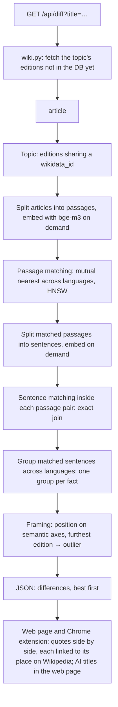
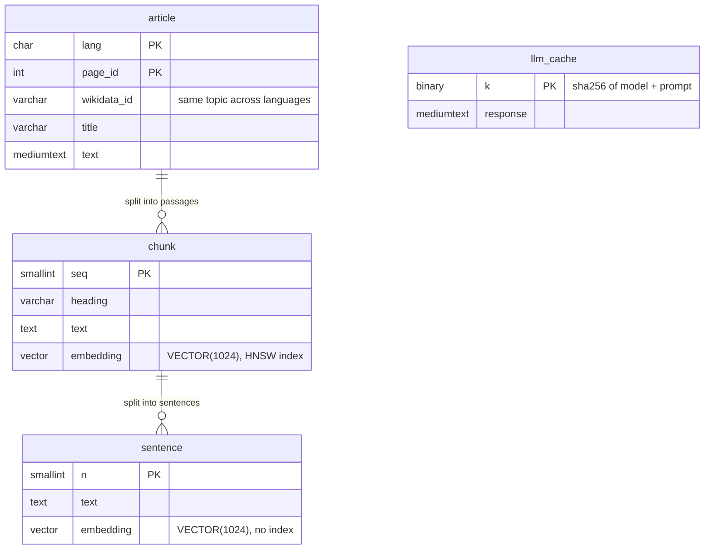
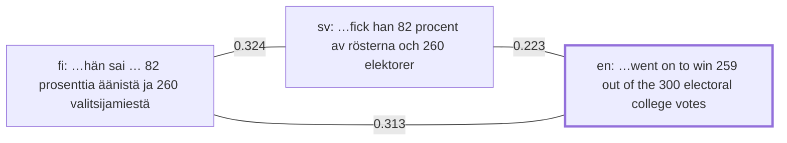
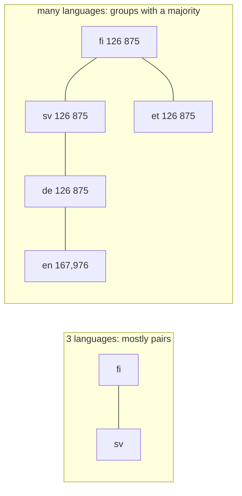
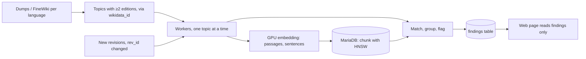
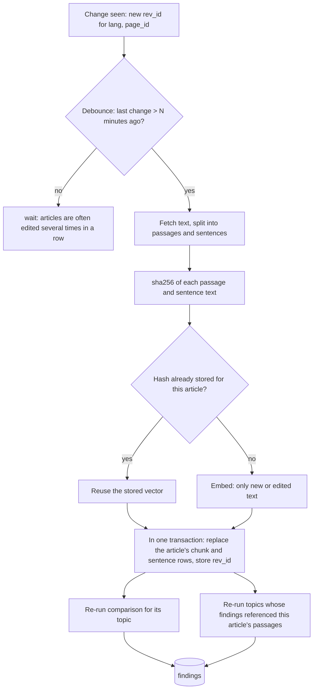

# How WikiCross works

WikiCross finds where the Wikipedia editions of one topic **frame the same thing differently**:
every Latin- or Cyrillic-script edition is fetched live from Wikipedia on the topic's first request
(`wiki.py`). Detection needs no LLM: only bge-m3 vectors, compared inside MariaDB. The web page then
asks an LLM for each finding's title and description and for English translations of the quotes.

Passages in two of fi, sv and en are matched over every passage in the database with HNSW, as below.
Any pair involving another language is matched only inside the topic, by an exact join: HNSW filtered
to a language with a few articles would scan almost the whole index. Framing statistics fall back to
all languages pooled for a language with fewer than 200 sentences.

Every edition now comes from live Wikipedia. The measurements below date from when WikiCross was built
on dataset S of mariadb-wikipedia-datasets (history of Finland: 29,460 articles in fi, sv, en), embedded
with Ollama on one laptop CPU, unless marked otherwise; that loader has since been removed.

## The pipeline at a glance



Two different questions are answered by two different mechanisms:

| Question | Mechanism | What it never does |
|---|---|---|
| *Are these about the same thing?* (matching) | vector distance: mutual nearest neighbour, under a threshold | flag anything |
| *Do they say it differently?* (flagging) | positions on semantic axes | decide what is about the same thing |

Content that only one edition has never finds a partner, so it is never reported: WikiCross is about
disagreement, not omission.

## Data model



`chunk` and `sentence` are filled on demand the first time a topic is asked for, then reused.

## One request

```mermaid
sequenceDiagram
  participant B as Browser
  participant API as FastAPI (/api/diff)
  participant DB as MariaDB
  participant O as Ollama (bge-m3)
  B->>API: title=Urho Kekkonen
  API->>DB: editions with the same wikidata_id
  alt passages not embedded yet
    API->>O: embed passages (≈2 per s on CPU)
    API->>DB: INSERT chunk
  end
  loop each passage × each other language
    API->>DB: ORDER BY VEC_DISTANCE_COSINE(...) LIMIT 1 (HNSW)
  end
  alt sentences not embedded yet
    API->>O: embed sentences (≈8 per s on CPU)
    API->>DB: INSERT sentence
  end
  API->>DB: one query: sentence pairs + axis positions (window functions)
  API->>API: group, flag values and framing
  par each finding on the page
    API->>API: explain: title, description, quotes in English (LLM, cached in llm_cache)
  end
  API-->>B: differences, explained
  opt "Show paragraphs", then "Expand up / down" (web page only)
    B->>API: GET /api/context (neighbouring sentences, from the sentence table)
  end
  opt "Show all" editions, paragraphs in English
    B->>API: POST /api/translate (quotes by place; the text comes from the database)
  end
```

## Step by step

### 1. Splitting

- **Passages** (`split()` in `app.py`): consecutive lines merged until ≥300 characters, never across a
  heading. Sections of sources and links (*Lähteet*, *Källor*, *References*…) and "Main article:"
  lines are skipped: they always differ and say nothing.
- **Sentences** (`sentences()`): split at `.!?` followed by a capital letter, quote or bracket; not
  before a digit, so Finnish "3. syyskuuta" and "(k. 1985)" stay whole. Pieces under 30 characters
  join a neighbour in the same line. Table rows and list items are one sentence each.

### 2. Matching

| Level | How | Threshold | Why this way |
|---|---|---|---|
| Article | same `wikidata_id` | — | exact, free |
| Passage | nearest passage in each other language **over the whole corpus** (HNSW), kept if mutual | cosine distance ≤ 0.40 | the counterpart can sit in another article (fi keeps *Talvisodan tausta* apart from *Talvisota*) |
| Sentence | nearest sentence **inside the matched passage pair**, kept if mutual (`ROW_NUMBER()` both ways) | ≤ 0.35 | a passage pair has a few dozen sentence pairs: an exact join beats index lookups |

"Mutual" means each is the other's nearest: one-to-one, so one long English paragraph cannot absorb
three Finnish ones.

### 3. Grouping across languages

Matched sentence pairs that connect (fi–sv, sv–en, pl–de, …) form one **group** per fact, with at
most one sentence per language. Pairs join groups closest first, and only when the two groups have no
language in common: a chain that would reach a second sentence of one language stops there, and that
pair is kept as a group of its own. Example: the three Urho Kekkonen passages on the 1978 election,
with their measured cosine distances:



Measured: with three languages most groups are still pairs (Urho Kekkonen: 27 three-language groups
and 90 pairs; Winter War: 8 and 37). Voting needs three; the more languages, the more groups have a
majority.

### 4. Flagging framing (`compare.py`)

An **axis** is the difference between the mean vectors of two groups of anchor sentences, written in
all three languages so that the language cancels out:

| Axis | Positive end (anchors) | Negative end (anchors) |
|---|---|---|
| evaluation | "a great success, widely praised", "heroic and admirable" | "a disastrous failure, widely condemned", "brutal and shameful" |
| certainty | "a well-documented fact", "confirmed by the records" | "an unconfirmed, disputed claim", "according to some sources … allegedly" |
| wording | "the ruthless aggressor savagely crushed the heroic defenders", "this shameful betrayal" | "the army attacked the positions and both sides suffered casualties", "the agreement was signed in 1940" |

The wording axis is about how, not which side: emotive words in either direction against neutral,
matter-of-fact ones. Urho Kekkonen, its strongest finding: et "Kekkonen võitles Nurmi osalemise eest
visalt ja isegi **ärritavalt jonnakalt**" (tenaciously and even irritatingly stubbornly) against fi's
plain "Kekkonen taisteli Nurmen osallistumisen puolesta", 3.4σ; the AI check, asked about tone,
agreed ("Estonian portrays Kekkonen as irritatingly stubborn").

A sentence's position is $p = 1 - d_{\cos}(s, \text{axis})$, computed in SQL. Languages sit at
slightly different places on every axis, so positions become z-scores against the language's own mean
and spread: $z_\ell = (p - \mu_\ell) / \sigma_\ell$. In a group, each edition's **deviation** is

$$\Delta_\ell = z_\ell - \frac{1}{|G|-1}\sum_{k \in G,\,k \neq \ell} z_k$$

With two editions this is just their difference. The largest $|\Delta|$ over editions and axes is
reported when it is at least 1.2σ; with three or more editions, that edition is the outlier.

### 5. Worked example (real output)

| Topic | Kind | Editions | Result |
|---|---|---|---|
| Urho Kekkonen | framing, pair, 3.0σ | fi "1978 presidentinvaalit olivat **riemuvoitto**" (a triumph) vs sv "var **enbart ett statspolitiskt skådespel**" (merely a political spectacle) | fi more positive |

## Measured cost

| What | Measured |
|---|---|
| Passage matching, HNSW (Winter War: 266 passages; Kekkonen) | 0.45 s; 0.21 s |
| Sentence matching, exact join inside passage pairs (Kekkonen, 183 pairs) | 0.01 s |
| Same alignment with one HNSW lookup per sentence (Winter War, 2,652 lookups) | 3.68 s vs 0.11 s for the join |
| Whole `/api/diff` once embedded (Kekkonen; Winter War) | 0.25 s; 0.50 s |
| Embedding with Ollama on CPU | ≈2 passages/s, ≈8 sentences/s |
| Dataset S, topics in ≥2 languages | 17,431 articles → 149,524 passages, 594,025 sentences |

Per article that is about **8.6 passages and 34 sentences**, i.e. about 43 vectors of 4 KB.

## Design decisions and tradeoffs

| Decision | Chosen | Alternative | Why |
|---|---|---|---|
| Who judges "different" | semantic axes | LLM per pair; rules about numbers; NLI on translations | an LLM call per matched pair is 35–60 calls per article. Two earlier versions flagged contradictions and were removed: number rules (missed names, dates and outcomes; paired unrelated figures) and NLI classifiers on machine translations (about half the findings real, minutes per topic's first load; commit `56dcbbe`) |
| Matching rule | mutual nearest + threshold | nearest only | one-to-one: a long paragraph cannot match everything |
| Passage search | HNSW over the whole corpus | exact join within the topic | finds counterparts in other articles; stays fast as the corpus grows |
| Sentence search | exact join within passage pairs | HNSW | measured 0.11 s vs 3.68 s; exact; no index to maintain on the largest table |
| Language bias on axes | per-language z-scores, anchors in every language | raw positions | raw positions differ per language before any content does |
| Embedding | on demand, cached | precomputed | no upfront job for a demo; `TODO.md` describes the precompute |

## Limitations

- **Only tone.** Facts only one edition states are never reported (no partner), and neither are
  editions stating different facts.
- **Framing is noisy.** Strong hits (≥2σ) are usually real; around 1.2–1.5σ, many are
  wording differences (Urho Kekkonen: 11 framing findings, the top 3 convincing).
- **Three axes.** Others (blame/agency, nationalist vs neutral framing) would need their own anchors
  and checking. The wording axis also fires on sentences that differ in a fact rather than in tone
  ("largest" vs "second largest" national park).
- **Thresholds are tuned on two articles** (Winter War, Urho Kekkonen).

## Scaling to more languages

What carries over unchanged: bge-m3 covers 100+ languages in one vector space, so matching works as
is; z-scores are per language, so a new language gets its own baseline from its own data.

What needs work:

| Piece | Today | With more languages |
|---|---|---|
| Language list | `LANGS` (fi, sv, en: matched with HNSW, listed first) in `db.py`, the page | from the data |
| Sentence splitter | `.!?` + an uppercase letter of any alphabet (Latin, Cyrillic) or an opening quote/bracket | per script: CJK `。`, Arabic `؟`, Thai has no sentence punctuation |
| Axis anchors | fi, sv, en | add anchors in each language; check each axis per language |
| Passage lookups | 2 per passage | L−1 per passage, plus reverse lookups for mutuality |

**Groups get better with more languages.** Pairwise comparison grows as $L(L-1)/2$ language pairs (45
for 10 languages); groups need one sentence per language per fact, and a majority vote says *which*
edition is the outlier. With three languages a majority is rare (most groups are pairs); with ten,
most facts are covered several times.



**Risk to check before adding many languages: filtered HNSW.** Passage lookups filter by language
(`WHERE lang = %s ORDER BY VEC_DISTANCE_COSINE(...) LIMIT 1`). MariaDB served this from the vector
index with a filter during the scan (`EXPLAIN`: `key: embedding`, `Using where`). With three
languages a third of all passages pass the filter; with 300 languages, a fraction of a percent does,
and the index may need to visit far more nodes to find one. Untested here; options are one table (and
index) per language, or one per group of languages, and measuring recall against the exact join.

## Scaling to all of Wikipedia

Run it as a batch job, not on request:



- **Topics are independent.** Everything after embedding works on one `wikidata_id` at a time, so it
  parallelises across workers; only the passage search touches the whole corpus, and that is an index
  lookup.
- **Only topics with ≥2 editions** need passages and sentences at all.
- **Embedding dominates.** At the measured CPU rates one article costs about $8.6/2 + 34/8 \approx 8.6$
  s; per million articles that is about 100 CPU-days. A GPU is required; its throughput was not
  measured here.
- **Storage**, at about 43 vectors of 4 KB per article: about 175 GB per million articles, ~80 % of it
  sentence vectors. Sentence vectors are only needed while aligning, so a batch job can embed,
  align, flag and discard them, keeping only passages (~35 GB per million articles) and findings.
- **HNSW memory.** The passage index must fit the server's vector-index cache to stay fast; size the
  MariaDB vector index cache for it (not measured here).
- **Framing statistics** (`axis_stats()`) are computed today by scanning every sentence once per
  process; at scale, compute them once per bulk load and store them in a table.
- **Updates.** Re-embed and re-compare only what changed: see the next section.
- **The LLM stays out of detection.** It titles and describes the findings people look at (one call
  per finding on a page), not every matched pair.

## Recomputing embeddings when an article changes

Articles are edited all the time; the stored vectors describe the text they were made from.

**Today nothing detects a change.** `ensure_chunks()` and `ensure_sentences()` only check whether an
article has rows at all, and `wiki.py` fetches a topic's editions once (`topic_editions`) and keeps no
revision: findings may quote text that has changed since. To refresh a topic until the steps below
exist: delete its `topic_editions` row, its `article` rows and their `chunk` /
`sentence` rows; the next request fetches it again.

**What goes stale when one edition of a topic changes:**

| What | Stale? | Why |
|---|---|---|
| That article's `chunk` and `sentence` rows | the edited passages | their text changed |
| Findings of its topic | yes | they quote and compare the old text |
| Findings of *other* topics | sometimes | a passage of this article may have been the cross-article counterpart of a passage elsewhere (HNSW search over the whole corpus) |
| Framing statistics | negligibly | per-language means over millions of sentences barely move |
| `llm_cache` | no action | keyed by the text: new text simply misses the cache |

**Recompute incrementally, by content hash.** An edit usually touches a few paragraphs, so the cost
should follow the size of the edit, not of the article:



What that needs:

1. **Store the revision**: a `rev_id` column in `article` (the MediaWiki API returns it) and the
   `rev_id` each article's rows were made from, so "stale" is a comparison, not a guess.
2. **Store a content hash** per passage and sentence (`sha256(text)`, `BINARY(32)`). Positions shift
   when a paragraph is inserted, so rows are matched by hash, not by `seq`. Rewrite an article's rows
   in one transaction (delete, insert with reused or new vectors) so a reader never sees half of it.
3. **Track who used a passage**: findings store the `(lang, page_id, seq)` of every member, so the
   topics to recompute after an edit are one query away, including cross-article matches.
4. **A change feed**: Wikimedia's EventStreams (revision events, near real time) for live updates, or
   a diff of `rev_id` between two dumps / FineWiki snapshots for periodic batches.

Cost of one edit: embedding the changed passages and sentences (≈0.5 s per passage, ≈0.13 s per
sentence on the measured CPU), a few HNSW lookups per changed passage, and one comparison of the
topic (0.25–0.5 s measured). MariaDB keeps the HNSW index on `chunk` up to date on every insert and
delete; whether heavy churn degrades its recall over time was not measured here; if it does, rebuild
the index periodically.
